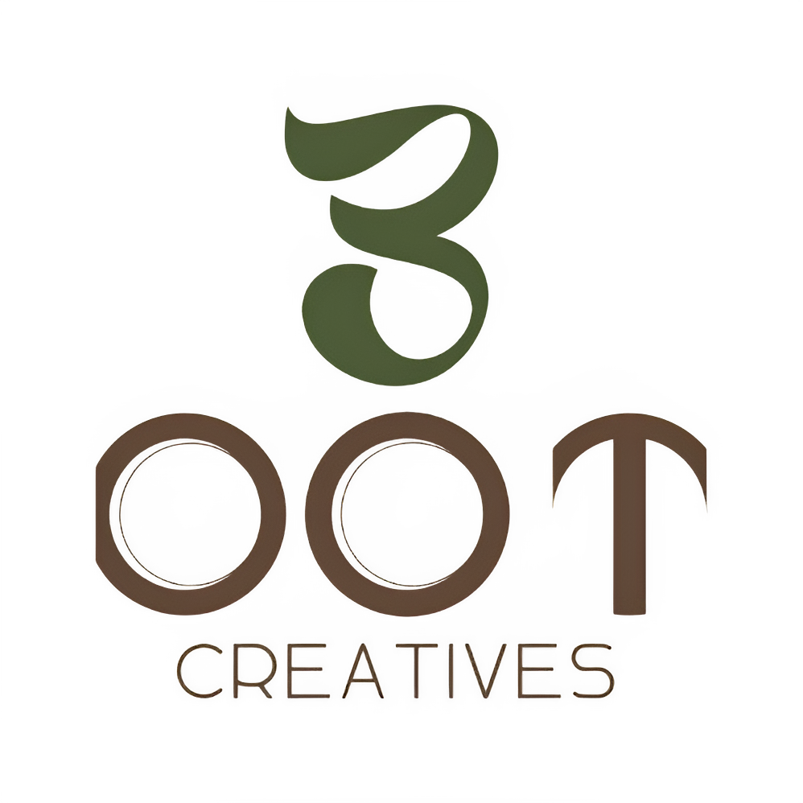

<div align="center">



# ✦ 3DOT CREATIVES POS & RESTAURANT ECOSYSTEM ✦

### *A Luxury Creative Studio POS, Inventory & Restaurant Suite*

<p align="center">
  
  
  
  
  
</p>

<p align="center">
  <a href="#-the-vision"><b>The Vision</b></a> •
  <a href="#-studio-brand-identity"><b>Brand Identity</b></a> •
  <a href="#-core-architecture--role-portals"><b>Role Portals</b></a> •
  <a href="#-key-features"><b>Key Features</b></a> •
  <a href="#-demo-credentials"><b>Credentials</b></a> •
  <a href="#-quick-start"><b>Quick Start</b></a>
</p>

---

</div>

## ✦ The Vision

Engineered for **3Dot Creatives** ([3dotcreatives.agency](https://3dotcreatives.agency)), this ecosystem transcends utilitarian POS software by delivering an **editorial, studio-grade restaurant and retail suite**. It bridges liquid frosted glass ergonomics, dynamic count-up physics, and split-second keyboard-driven ordering for modern hospitality spaces.

---

## 🎨 Studio Brand Identity & Palette

Crafted in alignment with the official **3dotcreatives Studio Design System** — balancing high-contrast dark cinematic ambiance with warm editorial craftsmanship:

| Proportion | Swatch | Color Name | Hex Code | Purpose & Application |
| :---: | :---: | :--- | :---: | :--- |
| **60%** | `●` | **Warm Cream** | `#F4EBDD` | Headings, hero labels, primary readable typography |
| **Supporting** | `●` | **Soft Beige** | `#D8C3A5` | Secondary text, subtle borders, muted badges |
| **30%** | `●` | **Olive Green** | `#59613B` | Structural buttons, status pills, category pills |
| **10%** | `●` | **Rusty Gold** | `#B98245` | High-impact callouts, focus rings, glowing accents |
| **Contrast** | `●` | **Dark Olive** | `#303522` | Cards, pill containers, deep contrasting surfaces |
| **Canvas** | `●` | **Midnight Black** | `#0E100C` | Frosted liquid-glass canvas, deep cinematic backdrop |

### ✒️ Editorial Typography Trio
- **Headings**: *Cormorant Garamond* — Refined, timeless editorial elegance
- **Body & Controls**: *Plus Jakarta Sans* — High-legibility modern geometric sans
- **Metrics & Hotkeys**: *JetBrains Mono* — Monospaced tabular digits with easing physics

---

## 🏛️ Core Architecture & Role Portals

| Portal | Primary Route | Target Operator | Core Responsibilities |
| :--- | :--- | :--- | :--- |
| **🛡️ Admin HQ** | `/admin/dashboard` | Owners / General Managers | Real-time sales ledger, recipe yield costing, purchase billing, multi-cashier shift variance audits, analytical reports |
| **⚡ Cashier Desk** | `/cashier/pos` | Front Counter Cashiers | High-speed barcode scan, `F1-F12` hotkeys, held orders, split payments, cash drawer float tracking |
| **🍳 Kitchen KDS** | `/kitchen/dashboard` | Head Chefs & Line Cooks | Real-time live KOT queue, order timers with alert badges, audio chimes, and station dispatch |
| **🍽️ Waiter Floor** | `/waiter/dashboard` | Floor Servers & Captains | Interactive table layout, digital order pads, guest billing statuses |
| **🛵 Rider Fleet** | `/rider/dashboard` | Delivery Fleet Riders | Dispatch queue, GPS delivery verification, one-touch customer WhatsApp updates |

---

## ✨ Key Features

- **Liquid-Glass Sidebar**: Frosted-glass navigation with role-aware smart filtering (cashiers see only their desk; admins see all management hubs).
- **1-to-100 Cinematic Splash Loader**: Visual linear progress indicator counting smoothly from `1% → 100%` before transitioning into the workspace.
- **Dynamic Easing Count-Up Metrics**: Numbers count up on load (`requestAnimationFrame` with `easeOutExpo`) instead of abruptly popping in.
- **Hotkey-Accelerated POS**:
  - `F1` Express Sale Terminal
  - `F3` Quick Stock Look-up
  - `F8` Cash Shift & Drawer Balance
  - `Alt + P` Product Search
  - `Alt + C` Barcode Focus
  - `Alt + E` Complete Payment & Print
- **Zero-Friction Shifts & Audit**: Shift drawer balances with automated surplus/shortage detection (`-Rs. 50 (Short)` audit pills).
- **Desktop Ready (Electron)**: Ships both as a responsive PWA and an offline-first Windows/macOS desktop application.

---

## 🔐 Demo Credentials

Experience each role's dedicated environment:

| Account | Email | Password | Allowed Capabilities |
| :--- | :--- | :--- | :--- |
| **Admin** | `admin@3dotcreatives` | `admin123` | Full access across all 4 hubs, financials, recipes, & settings |
| **Cashier** | `cashier@3dotcreatives` | `cashier123` | Streamlined access: POS Register, Orders Queue, Shifts & Drawer |

---

## 🚀 Quick Start

### 1. Prerequisites
- **Node.js** 18.18+ or 20+
- **npm** or **pnpm**

### 2. Setup & Installation
```bash
# Clone the repository
git clone https://github.com/Muhammad-Saad28/3dotcreativespos.git
cd 3dotcreativespos

# Install dependencies
npm install

# Start development server
npm run dev
```

Visit [http://localhost:3000](http://localhost:3000) to view the application.

---

## 🖥️ Desktop Application (Electron)

```bash
# Run local desktop application with hot reload
npm run desktop:dev

# Package Windows/macOS production installer (.exe)
npm run desktop:dist
```

---

## 🛠️ Technology Stack

- **Framework**: [Next.js 15 (App Router)](https://nextjs.org/)
- **UI Architecture**: [React 19](https://react.dev/)
- **Design Tokens**: [Tailwind CSS v4](https://tailwindcss.com/)
- **Desktop Runtime**: [Electron 34](https://www.electronjs.org/)
- **Icons**: [Lucide React](https://lucide.dev/)
- **Visual Charts**: [Recharts](https://recharts.org/)
- **Micro-interactions**: [Framer Motion](https://www.framer.com/motion/)

---

<div align="center">

Crafted with care for **3Dot Creatives Agency**  
*Sophisticated • Artistic • Confident • Minimal • Timeless*

</div>
