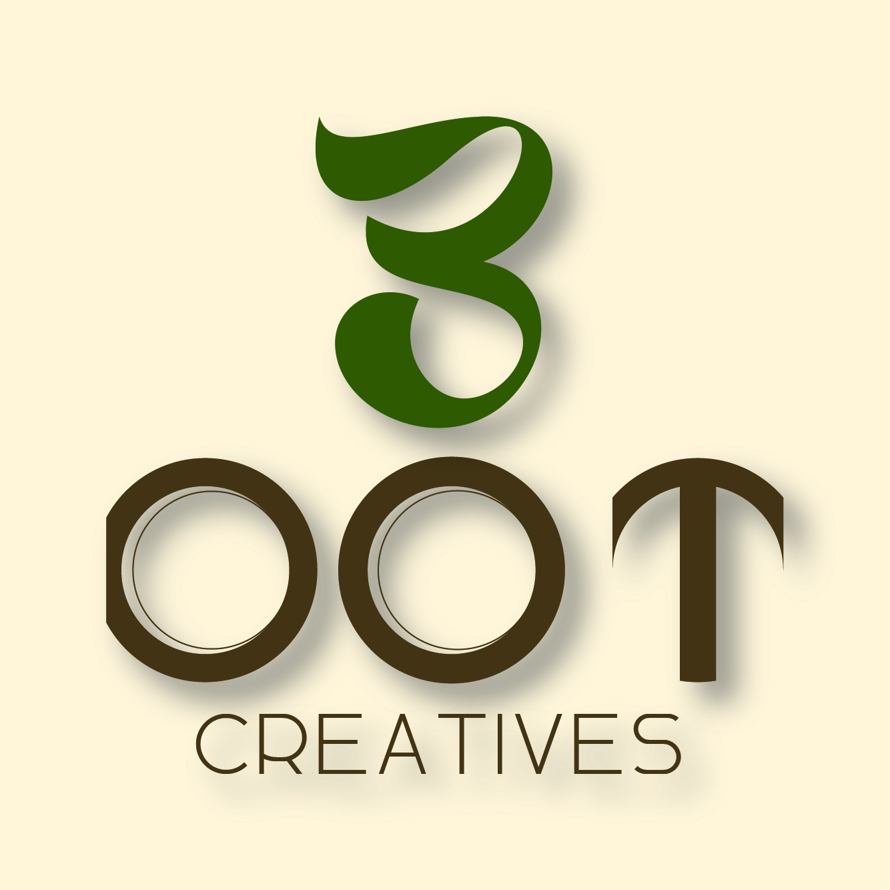
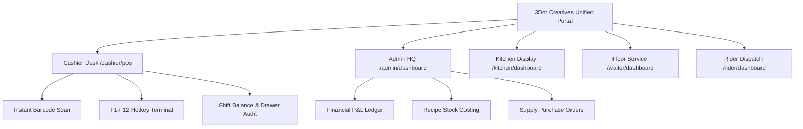

<div align="center">



# 3DOT CREATIVES POS & RESTAURANT ECOSYSTEM

### *A High-End Creative Studio POS, Inventory & Restaurant Suite*

[](https://nextjs.org/)
[](https://react.dev/)
[](https://tailwindcss.com/)
[](https://www.electronjs.org/)
[](#)

[Live Demo & Portal](https://3dotcreatives.agency) • [Key Features](#-key-features) • [Design System](#-studio-brand-identity) • [Role Portals](#-role-based-portals) • [Quick Start](#-quick-start)

---

</div>

## ✦ The Vision

Engineered for **3Dot Creatives**, this POS ecosystem is conceived not as a generic utility, but as a **luxury studio-grade management suite**. Blending liquid-glass aesthetics, dynamic easing micro-interactions, and high-frequency operational speed, it caters to high-volume restaurants, bistros, and creative studios.

---

## 🎨 Studio Brand Identity & Aesthetic

The interface is built strictly around the **3dotcreatives Studio Design System**, harmonizing a warm editorial feel with dark cinematic realism:

| Role | Color Name | Hex Code | Visual Application |
| :--- | :--- | :--- | :--- |
| **60% Primary Light** | Warm Cream | `#F4EBDD` | Headings, hero labels, prime typography |
| **Secondary Surface** | Soft Beige | `#D8C3A5` | Subtle text, borders, glass reflections |
| **30% Brand Accent** | Olive Green | `#59613B` | Structural buttons, status pills, tags |
| **10% Premium Accent** | Rusty Gold | `#B98245` | Focus rings, key actions, glowing accents |
| **Typography Base** | Dark Olive | `#303522` | Deep contrast, dark section badges |
| **Dark Cinematic Mode** | Midnight Black | `#0E100C` | Frosted liquid-glass canvas, deep background |

### ✒️ Editorial Typography Trio
- **Headings**: *Cormorant Garamond* — Refined, timeless, sophisticated serif
- **Body & Controls**: *Plus Jakarta Sans* — Ergonomic, ultra-legible modern geometric sans
- **Metrics & Hotkeys**: *JetBrains Mono* — Tabular numbers with smooth count-up physics

---

## ✨ Key Features

- **Liquid-Glass Floating Navigation**: Persistent, frosted-glass sidebar with multi-depth ambient lighting reflections, spring animations, and automatic role-based navigation filtering.
- **Cinematic Startup Experience**: Interactive orbital splash screen with continuous `1% → 100%` liquid progress bar and smooth cross-fade into authentication.
- **Live Incremental Metrics**: Zero-abrupt jumps — numbers count up gracefully from 1 to their actual value with exponential easing (`easeOutExpo`).
- **Offline-First & Lightning Hotkeys**: Full keyboard-only terminal workflow (`F1` Sale, `F3` Stock, `F8` Shift Drawer, `Alt+P` Product, `Alt+C` Barcode, `Alt+E` Pay).
- **Split-Role Security Isolation**: Cashier operators enjoy a clutter-free, dedicated POS desk while Admin management suite holds full financial, procurement, and inventory control.
- **Cross-Platform Readiness**: Runs natively on modern browsers and packages as an ultra-fast local desktop executable via Electron.

---

## 🏛️ Role-Based Portals



### 1. 🛡️ Admin Management Suite (`/admin/dashboard`)
- **Floor & Service Hub**: Live revenue charts, tables & dining floor status, multi-cashier shift variance ledger.
- **Kitchen & Recipes Hub**: Raw ingredient stock tracking, recipe yield costing, unit conversions.
- **Supply & Procurement Hub**: Supplier accounts, purchase bills, return vouchers, inventory aging.
- **Financial HQ**: Income statements, operating overheads, customer credit ledgers, multi-role staff access control.

### 2. ⚡ Cashier Front Counter (`/cashier/pos`)
- High-speed product catalog with category pills, image previews, and barcode reader integration.
- Split payment modes (Cash, Credit Card, Bank Transfer, Split Bills).
- Customer ledger linking (Walk-In, Phone search, quick account creation).
- Cash float drawer audit with real-time shortage and surplus flags.

### 3. 🍳 Kitchen Display System (`/kitchen/dashboard`)
- Real-time KOT tickets categorized by table number, order type, and preparation timer.
- Dynamic color alerts for delayed tickets and instant sound chimes.

### 4. 🍽️ Waiter Floor Mobile App (`/waiter/dashboard`)
- Table floor map with status (Vacant, Dining, Billed).
- Mobile order drafting directly at the dining table.

### 5. 🛵 Rider Dispatch Queue (`/rider/dashboard`)
- Direct order assignment, status progression, and one-tap customer WhatsApp updates.

---

## 🚀 Quick Start

### Prerequisites
- **Node.js** 18.18+ or 20+
- **npm** or **pnpm**

### Installation

1. **Clone the repository**:
   ```bash
   git clone https://github.com/3dotcreatives/pos-suite.git
   cd 3dotpos
   ```

2. **Install dependencies**:
   ```bash
   npm install
   ```

3. **Configure Environment**:
   ```bash
   cp .env.example .env.local
   ```

4. **Launch the Development Server**:
   ```bash
   npm run dev
   ```
   Open [http://localhost:3000](http://localhost:3000) to view the application.

---

## 🖥️ Desktop App (Electron)

Launch or package the native Windows / macOS desktop application:

```bash
# Run local desktop application with hot-reload
npm run desktop:dev

# Build distributable production executable (.exe)
npm run desktop:dist
```

---

## 🔐 Demo Credentials

Quickly test the segregated role workflows:

| Role | Email | Password | Allowed Access |
| :--- | :--- | :--- | :--- |
| **Admin** | `admin@3dotcreatives` | `admin123` | Full access to all 4 management suites & reports |
| **Cashier** | `cashier@3dotcreatives` | `cashier123` | POS Register, Order Queue, Shifts, Receipts |

---

## 🛠️ Tech Stack Architecture

- **Framework**: [Next.js 15 (App Router)](https://nextjs.org/)
- **Frontend Engine**: [React 19](https://react.dev/)
- **Styling**: [Tailwind CSS v4](https://tailwindcss.com/) with Custom Frosted Glass System
- **Desktop Wrapper**: [Electron 34](https://www.electronjs.org/)
- **Icons**: [Lucide React](https://lucide.dev/)
- **Visual Analytics**: [Recharts](https://recharts.org/)
- **Animations**: [Framer Motion](https://www.framer.com/motion/)

---

<div align="center">

Crafted with precision for **3Dot Creatives Agency**  
*Sophisticated • Artistic • Confident • Minimal • Timeless*

</div>
